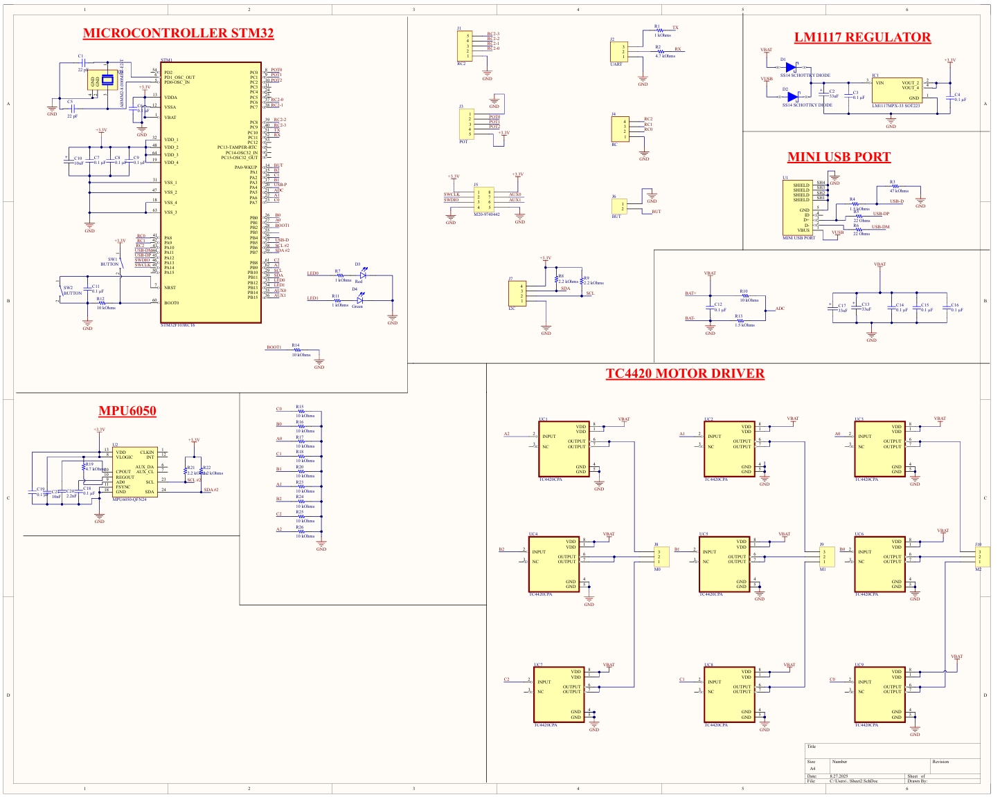
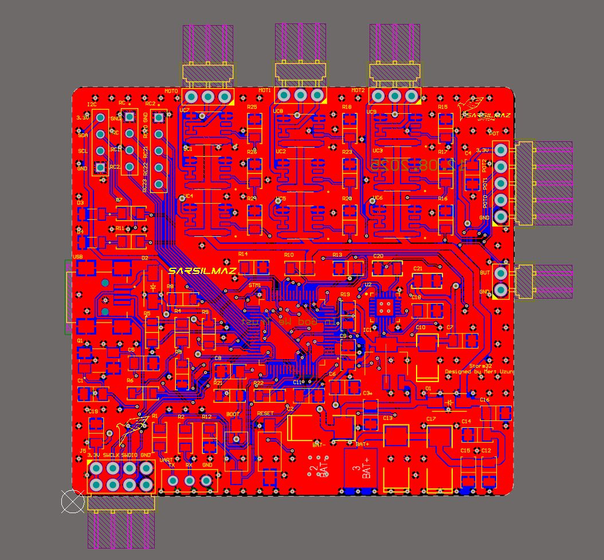
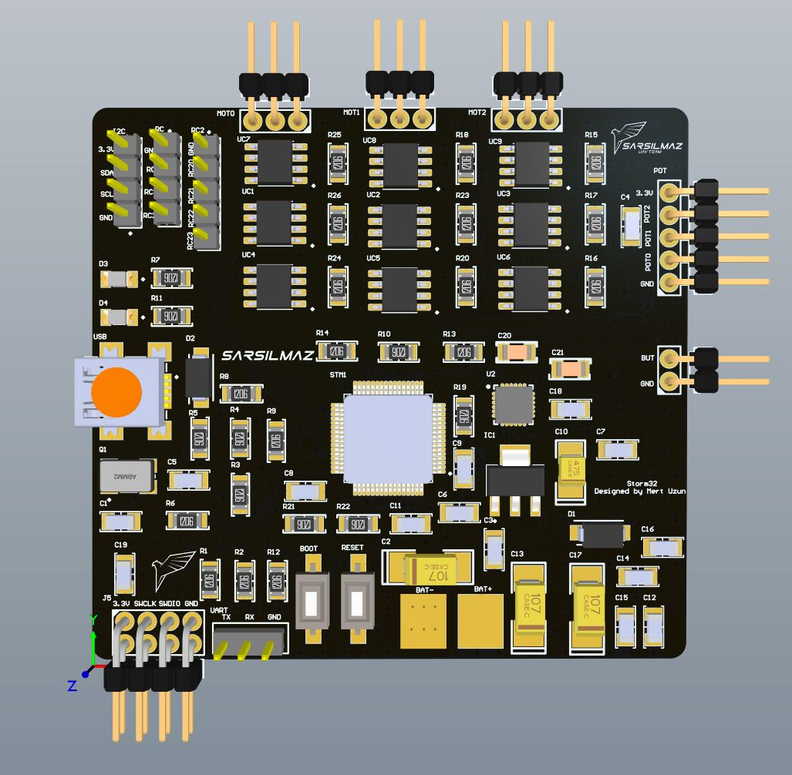
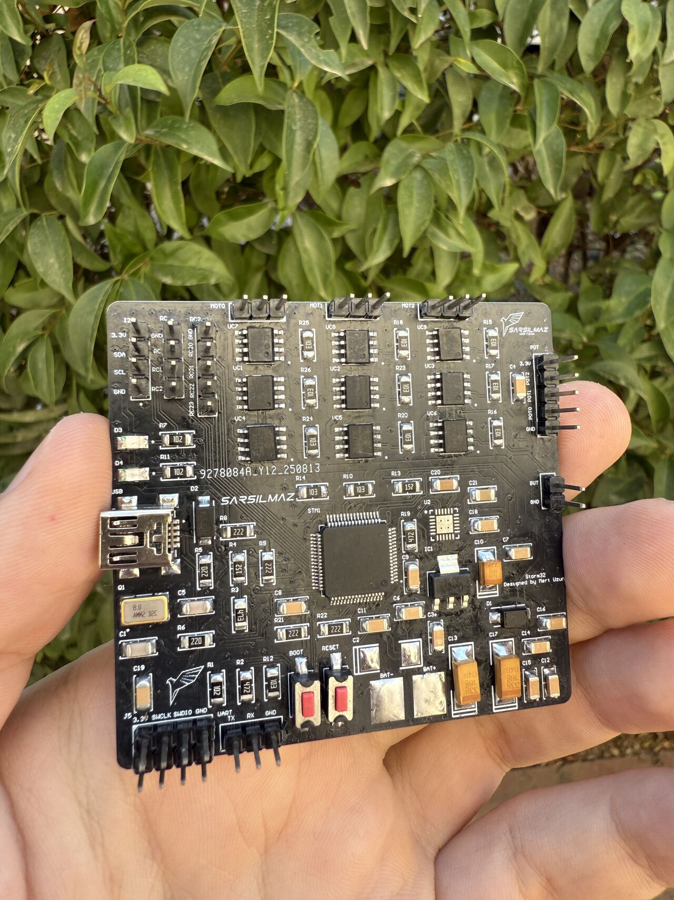
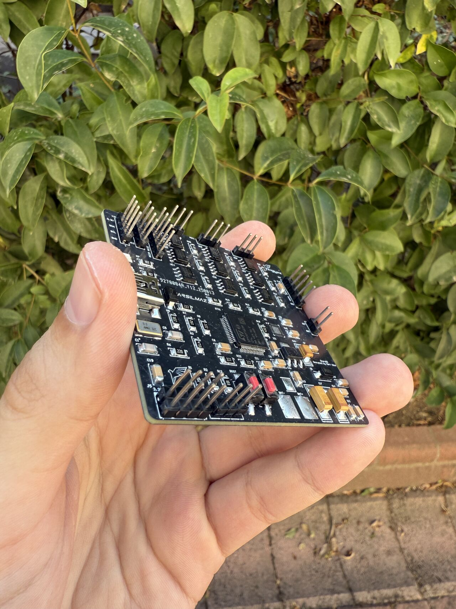

[Türkçe](README.md) | **English**

# STM32-Based Gimbal Controller Board

A hardware project for UAV camera stabilization that combines an STM32F103RCT6, an MPU6050, and driver stages for three axes on a single PCB.

**Status:** The board was manufactured, integrated into the gimbal system, and operated. This repository contains the board design, manufacturing files, and images; control firmware and quantitative stabilization test results are not published.

## System Architecture

The design transfers MPU6050 measurements to the STM32 over I²C. The microcontroller controls the driver stages for three axes. The board includes programming, communication, and auxiliary input/output connections.

| Component | Role |
|---|---|
| STM32F103RCT6 | Main microcontroller |
| MPU6050 | Acceleration and angular velocity measurements |
| 9 × TC4420CPA | Driver stages for three axes; three channels per axis |
| LM1117-3.3 | 3.3 V regulation |
| Mini USB | Onboard USB connection |

## Connection Interfaces

| Connector | Description |
|---|---|
| J8 / J9 / J10 | Motor outputs; M0, M1, M2 |
| J3 | SWD programming and debugging |
| J4 | RC input |
| J1 | Four-channel RC connection |
| J7 | I²C |
| J2 | UART |
| J5 | Auxiliary outputs |
| J6 | Button input |

This repository does not provide a verified numerical operating range for supply voltage or motor load limits. The VBAT label alone does not define an operating voltage range.

## Design and My Contribution

I worked on system requirements, main component selection, schematic preparation, and PCB design. I included the STM32 power, clock, reset, and programming circuits, as well as the MPU6050 connections, driver stages, and communication interfaces. After design checks, I prepared manufacturing files and followed the board production process.

During placement, I paid attention to separating the IMU from high-current driver traces, keeping bypass components close to the relevant devices, and maintaining access to programming connections.

## Validation Scope

Board manufacturing and system integration were completed. Quantitative records of closed-loop stabilization performance, temperature limits under motor load, and axis accuracy are not published in this repository.

Additional validation records that could be published:

- Tested supply voltage and motor load
- IMU acquisition and programming tests
- Control firmware and the method used
- Stabilization error, response time, and driver temperatures

## Repository Contents

| File | Contents |
|---|---|
| [10.08.2025.PrjPcb](10.08.2025.PrjPcb) | Altium project file |
| [Sheet2.SchDoc](Sheet2.SchDoc) | Schematic source |
| [PCB2.PcbDoc](PCB2.PcbDoc) | PCB source |
| [10.08.pdf](10.08.pdf) | PDF design output |
| [Bill of materials](10.08.2025_malzeme%20listesi.pdf) | BOM document |
| [Manufacturing outputs](Project%20Outputs%20for%2010.08.2025.rar) | Existing manufacturing archive |
| CAMtastic files | Existing CAM outputs |

## Images

### Schematic

### PCB Design
<table>
<tr><td></td><td></td></tr>
</table>

### Manufactured Board
<table>
<tr><td></td><td></td></tr>
</table>

[Mert Uzun - Project Portfolio](https://github.com/mertuzun41/Projeler/blob/main/README.en.md) | [LinkedIn](https://www.linkedin.com/in/mert-uzun-b74459308)
